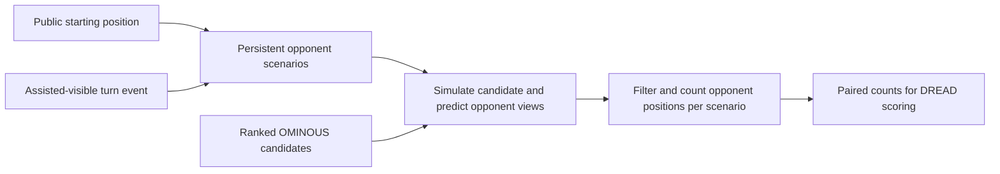

# DREAD uncertainty counter

The counter estimates how many distinct board positions the opponent could believe before and after each candidate move. It keeps the counts paired because the opponent can receive different observations depending on which assisted-consistent history is real.



## Observation log handoff

Create one `OpponentUncertaintyCounter(assisted_color)` per game and feed it events in order from ply 1. Each `AssistedTurnEvent` carries these facts.

| Field | Value |
| --- | --- |
| `ply` | The number of moves played by both sides since the public starting position. |
| `own_move` | The assisted player's `chess.Move` on their own move, otherwise `None`. |
| `observation` | The assisted player's `BoardObservation` at turn start or after their own move when Player Transition shows it. Use `None` when there is no displayed view, including at game end. |
| `show_mover_view` | The Player Transition setting for that ply. It also determines whether the model gives the opponent a post-move view on their turn. |
| `captured_piece`, `outcome` | The public capture as a `chess.Piece` and the `FowBoard` outcome as a `chess.Outcome`, each `None` when absent. |

At the game boundary, use `observe_board(board, assisted_color)` to extract visible pieces, fog occupancy hints, and en passant visibility. Pass the resulting snapshot to the counter. The counter reconstructs its hypotheses from these events and the starting position. It owns the simulated boards and uses the base game's move, visibility, and draw rules.

`update_model(event)` reports `applied`, `incomplete`, or `invalid`. Its `ply` is the last committed ply. If an update hits a limit, retry that event before submitting the next ply. Process updates and evaluations serially for each game.

## Analyzer and scorer handoff

Once the existing engine has ranked its `MoveScore` entries, pass the top five moves and the current game ply at the future integration point.

```python
moves = [move for move, _ in scored_guesses[:5]]
results = counter.evaluate_candidates(moves, ply=current_ply)
```

Each result has the move in UCI, `scenario_measurements` with paired `before` and `after` counts, and min, max, and unweighted mean for the after counts. Different histories remain separate scenarios even when the counts match. When a candidate is legal in only some histories, its estimate describes those histories. `states_explored` counts successor positions checked across both perspectives, including work that led to repeated positions.

`estimated` means the model finished enumerating its scenarios. `incomplete` indicates a position or time limit. `invalid` covers an illegal candidate, a mismatched ply, the opponent's turn, or game end. Only `estimated` results carry counts. The default cap is 25,000 successor positions per update or candidate. Set `max_positions` or `timeout_seconds` at construction or for an individual call.

## Run locally

```sh
python -B -m uncertainty_demo
python -B -m unittest discover -s tests -v
```

The demo runs headlessly with the existing Python requirements. With White assisted and Player Transition off, `e2e4` yields 1 → 20. After replaying `1. e4 Nf6`, `g1f3` yields 20 → 25–246 and `e4e5` yields 20 → 1–2 across 13 scenarios each.
